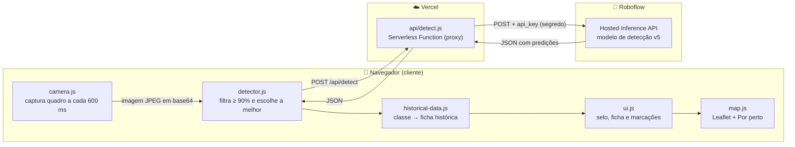
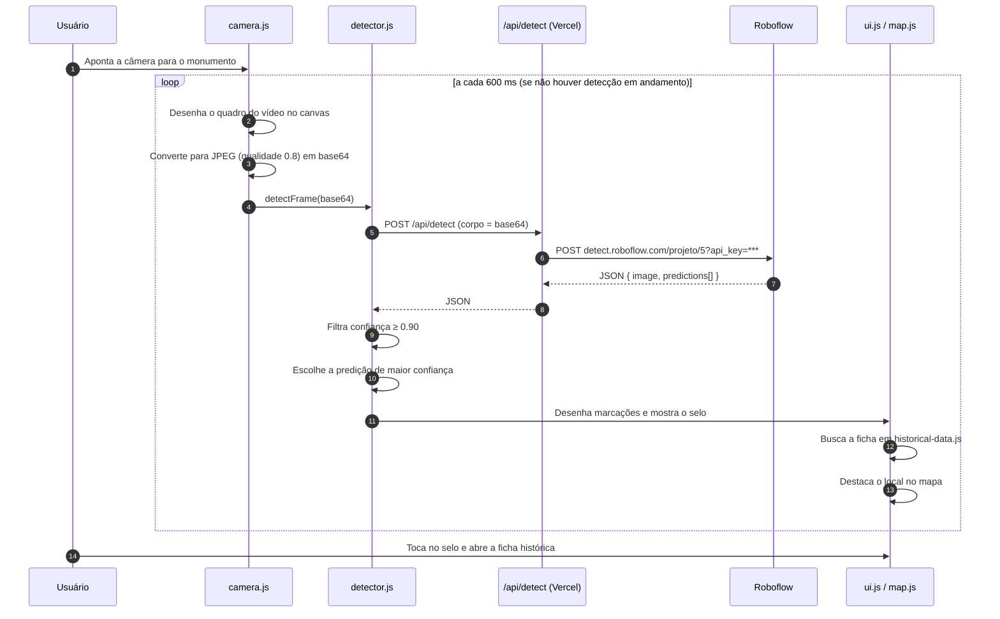

<div align="center">


# Monu Maps — História na Palma da Mão

**Guia turístico inteligente dos monumentos históricos de São Luís (MA), com reconhecimento por visão computacional em tempo real.**

Aponte a câmera do celular para um busto, estátua ou monumento do Centro Histórico e o app identifica o que você está vendo e conta a sua história.

[](https://monumapsv1.vercel.app)


</div>

---

## 🔬 Desenvolvido no Vision Lab

Este trabalho foi desenvolvido no **Vision Lab**, um **laboratório de pesquisa** dedicado à visão computacional e à inteligência artificial aplicada. O Monu Maps nasceu como um projeto de pesquisa aplicada do laboratório, com o objetivo de levar técnicas de **detecção de objetos** para fora do ambiente acadêmico e colocá-las a serviço da **valorização do patrimônio histórico e cultural do Maranhão**.

O projeto une três frentes de trabalho do laboratório:

- **Construção de dataset próprio**: coleta e anotação de imagens dos monumentos de São Luís.
- **Treinamento e versionamento de modelos** de detecção de objetos na plataforma Roboflow.
- **Aplicação real**: integração do modelo em um app web móvel usado diretamente pelo público, nas ruas do Centro Histórico.

---

## 📑 Sumário

- [Sobre o projeto](#-sobre-o-projeto)
- [Funcionalidades](#-funcionalidades)
- [Linguagem utilizada](#-linguagem-utilizada)
- [Tecnologias](#-tecnologias)
- [Arquitetura](#-arquitetura)
- [Integração do modelo de detecção com o Roboflow](#-integração-do-modelo-de-detecção-com-o-roboflow)
- [Classes reconhecidas pelo modelo](#-classes-reconhecidas-pelo-modelo)
- [Mapa interativo](#-mapa-interativo)
- [PWA (app instalável)](#-pwa-app-instalável)
- [Design e interface](#-design-e-interface)
- [Estrutura de pastas](#-estrutura-de-pastas)
- [Como executar localmente](#-como-executar-localmente)
- [Deploy na Vercel](#-deploy-na-vercel)
- [Como adicionar um novo monumento](#-como-adicionar-um-novo-monumento)
- [Segurança e privacidade](#-segurança-e-privacidade)
- [Créditos](#-créditos)

---

## 📖 Sobre o projeto

São Luís, capital do Maranhão, tem um dos maiores conjuntos de arquitetura colonial portuguesa da América Latina, e o seu Centro Histórico é Patrimônio Mundial da UNESCO. Espalhados por praças e avenidas estão dezenas de bustos, estátuas e monumentos que homenageiam escritores, poetas, políticos e episódios da história maranhense. Muitos visitantes e moradores passam por eles sem saber quem está ali representado.

O **Monu Maps** resolve esse problema de forma simples:

1. O usuário abre a aplicação no celular e aponta a câmera para um monumento.
2. Um **modelo de detecção de objetos treinado no Roboflow** reconhece o monumento em tempo real.
3. A aplicação mostra um selo com o nome do monumento e a confiança do reconhecimento.
4. Ao tocar no selo, abre-se uma ficha com **nome, período histórico, descrição e localização**.
5. O monumento é destacado em um **mapa interativo** do Centro Histórico, que também lista os monumentos próximos ao usuário.

Tudo roda no navegador, sem precisar instalar nada pela loja de aplicativos.

---

## ✨ Funcionalidades

| Funcionalidade | Descrição |
|---|---|
| 📷 **Reconhecimento em tempo real** | A câmera traseira captura um quadro a cada 600 ms e o envia para o modelo de detecção. |
| 🎯 **Filtro de alta confiança** | Só são aceitas detecções com **90% de confiança ou mais**, o que evita falsos positivos. |
| 🟨 **Marcação visual** | Cantos de foco amarelos são desenhados sobre o objeto detectado, no estilo de um visor de câmera. |
| 🏛️ **Ficha histórica** | Nome, período, descrição e localização de cada monumento, em português. |
| 🗺️ **Mapa interativo** | Mapa do Centro Histórico com pinos numerados para cada local, feito com Leaflet e OpenStreetMap. |
| 📍 **"Por perto"** | Com a localização do usuário, a lista de monumentos é ordenada pela distância real (fórmula de Haversine). |
| 🔎 **Busca** | Busca por nome ou local, que ignora acentos e maiúsculas/minúsculas. |
| 🔖 **Salvar monumentos** | O usuário pode salvar monumentos favoritos. A lista fica guardada no próprio aparelho (`localStorage`). |
---

## 💻 Linguagem utilizada

O projeto é escrito em **JavaScript puro (Vanilla JS)**, sem frameworks de interface como React ou Vue. Essa escolha mantém o app leve, rápido de carregar em redes móveis e fácil de entender para quem está começando no laboratório.

| Linguagem | Onde é usada | Detalhes |
|---|---|---|
| **JavaScript (ES2020+)** | Front-end e back-end | Organizado em **ES Modules** (`import`/`export`), com `async/await`, `fetch`, `Promise`, optional chaining (`?.`) e `Set`. No servidor, roda em **Node.js** dentro de uma Vercel Serverless Function. |
| **HTML5** | Estrutura das telas | Uso de elementos semânticos (`<nav>`, `<section>`, `<header>`), atributos de acessibilidade (ARIA) e das APIs `<video>` e `<canvas>`. |
| **CSS3** | Estilo visual | Variáveis CSS (design tokens), Flexbox, `backdrop-filter` para o efeito de vidro, animações e `env(safe-area-inset-*)` para telas com notch. |

APIs nativas do navegador utilizadas:

- **MediaDevices / `getUserMedia`**: acesso à câmera do aparelho.
- **Canvas 2D**: captura dos quadros do vídeo e desenho das marcações de detecção.
- **Geolocation API**: posição do usuário para a lista "Por perto".
- **Service Worker + Cache API**: funcionamento como PWA.
- **Web Storage (`localStorage`)**: monumentos salvos pelo usuário.
- **Pointer Events**: gesto de arrastar o painel do mapa.

---

## 🛠️ Tecnologias

| Tecnologia | Versão | Papel no projeto |
|---|---|---|
| [**Roboflow**](https://roboflow.com) | Modelo v5 | Plataforma usada para anotar o dataset, treinar e hospedar o modelo de detecção. A inferência é feita pela **Hosted Inference API**. |
| [**Vite**](https://vitejs.dev) | ^6.0.0 | Servidor de desenvolvimento com recarregamento rápido e empacotador (bundler) para produção. |
| [**@vitejs/plugin-basic-ssl**](https://github.com/vitejs/vite-plugin-basic-ssl) | ^2.3.0 | Gera um certificado HTTPS local. É necessário porque os navegadores só liberam a câmera em conexões seguras, o que permite testar no celular pela rede local. |
| [**Leaflet**](https://leafletjs.com) | 1.9.4 | Biblioteca de mapas interativos, carregada via CDN (unpkg). |
| [**OpenStreetMap**](https://www.openstreetmap.org) | — | Imagens (tiles) do mapa base. |
| [**Vercel**](https://vercel.com) | — | Hospedagem do site estático e execução da função serverless `/api/detect`. |
| **Node.js** | 18+ | Ambiente de execução da função serverless e das ferramentas de build. |
| **Service Worker** | — | Cache dos arquivos do app e suporte a instalação como PWA. |

---

## 🧱 Arquitetura

O app é dividido em três camadas: o **cliente** (navegador do celular), um **proxy serverless** na Vercel e o **modelo hospedado no Roboflow**.



### Responsabilidade de cada módulo

| Arquivo | Responsabilidade |
|---|---|
| `main.js` | Ponto de entrada. Controla a tela de boas-vindas, inicia a câmera, o loop de detecção e o mapa, e registra o Service Worker. |
| `camera.js` | Abre a câmera com `getUserMedia`, captura quadros em um canvas fora da tela, converte para JPEG base64 e controla o loop de captura. |
| `detector.js` | Envia o quadro para `/api/detect`, aplica o filtro de confiança, escolhe a predição mais confiável e aciona a interface. |
| `api/detect.js` | Função serverless que recebe a imagem, acrescenta a chave secreta e repassa a requisição ao Roboflow. |
| `historical-data.js` | Banco de dados em memória que relaciona cada classe do modelo à sua ficha histórica. Tem um *fallback* para classes não cadastradas. |
| `ui.js` | Gerencia as telas, o selo de reconhecimento, a ficha do monumento, as marcações no canvas e os monumentos salvos. |
| `map.js` | Cria o mapa Leaflet, os pinos, a lista "Por perto", a busca, a geolocalização e o painel inferior retrátil. |
| `public/sw.js` | Service Worker com estratégia *network first* e cache como alternativa quando não há rede. |

---

## 🤖 Integração do modelo de detecção com o Roboflow

Esta é a parte central do projeto. O reconhecimento dos monumentos é feito por um **modelo de detecção de objetos** treinado e hospedado no **Roboflow**, e o app conversa com ele pela **Hosted Inference API**.

### 1. O modelo

| Item | Valor |
|---|---|
| Plataforma | Roboflow |
| Tipo de tarefa | Detecção de objetos (*object detection*) |
| Projeto (ID) | `hisoria_na_palma_da_mao-bkhoi` |
| Versão em produção | `5` |
| Endpoint de inferência | `https://detect.roboflow.com/{PROJETO}/{VERSÃO}?api_key={CHAVE}` |
| Classes | 28 classes: bustos, rostos, estátuas e monumentos de São Luís (veja a [lista completa](#-classes-reconhecidas-pelo-modelo)) |

O fluxo de trabalho no Roboflow segue o ciclo de um projeto de visão computacional:

1. **Coleta**: fotos dos monumentos tiradas em campo, com ângulos, distâncias e iluminações variadas.
2. **Anotação**: cada monumento é marcado com uma *bounding box* e recebe uma classe (por exemplo, `maria_firmina_busto`).
3. **Geração de versões do dataset**: o Roboflow permite aplicar pré-processamento e *data augmentation* e congelar cada combinação como uma versão.
4. **Treinamento**: o modelo é treinado sobre uma versão do dataset. O app usa hoje a **versão 5**.
5. **Deploy**: o Roboflow publica o modelo treinado automaticamente em um endpoint HTTP, sem precisar de servidor próprio de GPU.

> 💡 Como o número da versão é uma variável de ambiente (`ROBOFLOW_VERSION`), é possível trocar o modelo usado em produção sem mexer no código. Basta treinar uma nova versão no Roboflow e atualizar a variável na Vercel.

### 2. Fluxo de uma detecção, passo a passo



### 3. Captura do quadro (`camera.js`)

A câmera é aberta com preferência pela **câmera traseira** e em **resolução baixa**, para que cada imagem seja pequena e chegue rápido à API:

```js
const constraints = {
  video: {
    facingMode: "environment",      // câmera traseira
    width:  { ideal: 640 },
    height: { ideal: 480 }
  },
  audio: false
};
```

A cada **600 ms**, o quadro atual do `<video>` é desenhado em um canvas fora da tela e convertido para **JPEG com qualidade 0.8** em base64. O prefixo `data:image/jpeg;base64,` é removido, pois o Roboflow espera só os dados da imagem:

```js
ctx.drawImage(video, 0, 0, canvas.width, canvas.height);
const base64Image = canvas.toDataURL('image/jpeg', 0.8).split(',')[1];
await detectFrame(base64Image, canvas.width, canvas.height);
```

**Controle de concorrência:** a flag `isDetecting` impede que um novo quadro seja enviado enquanto a resposta anterior não chegou. Assim, o app nunca acumula requisições quando a rede está lenta. O intervalo de 600 ms serve de limite superior, e o ritmo real se ajusta ao tempo de resposta da API.

### 4. Proxy seguro (`api/detect.js`)

O navegador **nunca** fala diretamente com o Roboflow. Ele envia a imagem para `/api/detect`, uma **Vercel Serverless Function** que:

1. Aceita apenas requisições `POST` (outros métodos recebem `405`).
2. Lê `ROBOFLOW_PROJECT`, `ROBOFLOW_VERSION` e `ROBOFLOW_API_KEY` das variáveis de ambiente do servidor. Se alguma faltar, responde `500`.
3. Lê o corpo da requisição (a imagem em base64) em *stream*.
4. Monta a URL do endpoint com a chave secreta e repassa a imagem ao Roboflow.
5. Devolve ao navegador o JSON de resposta, ou o código de erro do Roboflow, se houver.

```js
const url = `https://detect.roboflow.com/${PROJECT}/${VERSION}?api_key=${API_KEY}`;

const response = await fetch(url, {
  method: 'POST',
  body: base64Image
});
```

Com isso, a **chave de API fica protegida**: ela não aparece no código JavaScript enviado ao navegador nem nas requisições de rede visíveis no DevTools.

### 5. Resposta do modelo

O Roboflow devolve um JSON com as dimensões da imagem analisada e uma lista de predições. Cada predição traz a *bounding box* (centro `x`, `y`, `width`, `height`, em pixels), a classe e a confiança (de 0 a 1). Exemplo ilustrativo:

```json
{
  "time": 0.07,
  "image": { "width": 640, "height": 480 },
  "predictions": [
    {
      "x": 322.5,
      "y": 214.0,
      "width": 188.0,
      "height": 271.0,
      "confidence": 0.95,
      "class": "maria_firmina_busto",
      "class_id": 9,
      "detection_id": "a1b2c3d4-..."
    }
  ]
}
```

### 6. Pós-processamento no cliente (`detector.js`)

Depois que a resposta chega, o app aplica suas próprias regras:

```js
const MIN_CONFIDENCE = 0.9;

// 1) Mantém só as detecções com confiança ≥ 90%
const validPredictions = data.predictions.filter(p => p.confidence >= MIN_CONFIDENCE);

// 2) Desenha as marcações (ou esconde o selo, se não houver nada)
UIManager.drawDetections(validPredictions, data.image.width, data.image.height);

// 3) Escolhe a detecção mais confiável
const best = validPredictions.reduce((a, b) => (a.confidence > b.confidence ? a : b));

// 4) Busca a ficha histórica da classe e atualiza a interface
const info = getHistoricalData(best.class);
UIManager.showInfoPanel(info, best.confidence, best.class);
```

- **Por que 90%?** Em um guia turístico, mostrar a informação errada é pior do que não mostrar nada. Um limiar alto troca um pouco de sensibilidade por muito mais precisão.
- **Por que só a melhor predição?** O usuário normalmente aponta para um monumento por vez. Mostrar só o mais confiável deixa a interface limpa e sem ambiguidade.

### 7. Desenho das marcações (`ui.js`)

O Roboflow devolve as coordenadas no tamanho da imagem analisada. O app converte essas coordenadas para o tamanho do canvas sobreposto ao vídeo e transforma o **centro** da caixa no **canto superior esquerdo**, que é o formato usado pelo Canvas:

```js
const scaleX = canvas.width / imageWidth;
const scaleY = canvas.height / imageHeight;

const w = p.width * scaleX;
const h = p.height * scaleY;
const tlX = p.x * scaleX - w / 2;   // canto superior esquerdo
const tlY = p.y * scaleY - h / 2;
```

Em vez de um retângulo completo, são desenhados **quatro cantos de foco amarelos** (`#FFD60A`), no mesmo estilo do visor da câmera. Quando há detecção, a tela recebe a classe `has-detection` e o visor padrão some.

### 8. Da classe do modelo para a ficha histórica (`historical-data.js`)

Cada classe que o modelo retorna é uma **chave** no banco de dados em memória:

```js
"maria_firmina_busto": {
  name: "Maria Firmina dos Reis",
  period: "1822 - 1917",
  description: "Considerada a primeira romancista brasileira...",
  location: "Praça Pantheon, Centro Histórico"
}
```

> ⚠️ **As chaves precisam ser idênticas às classes do Roboflow**, inclusive em maiúsculas e minúsculas (por exemplo, `Ferreira_Gullar_Rosto` e `josue_montello_Busto`).

Se o modelo retornar uma classe que ainda não foi cadastrada, a função `getHistoricalData` não quebra. Ela gera uma ficha genérica, formatando o nome da classe (`artur_azevedo_busto` vira "Artur Azevedo") e usando "Patrimônio Maranhense" como período.

### 9. Ligação com o mapa

Vários monumentos ficam no mesmo lugar. Os bustos da Praça do Panteon, por exemplo, ficam todos juntos. Por isso, `map.js` agrupa várias classes do modelo em um único pino. Quando o modelo reconhece `maria_firmina_busto`, o pino da **Praça do Panteon** é destacado automaticamente.

### 10. Desempenho e custo

| Decisão | Efeito |
|---|---|
| Resolução de 640×480 | Imagens pequenas, upload rápido em 4G. |
| JPEG com qualidade 0.8 | Bom equilíbrio entre tamanho do arquivo e nitidez para o modelo. |
| Intervalo de 600 ms + flag `isDetecting` | No máximo uma requisição em andamento. Evita filas e reduz o consumo da cota da API. |
| Service Worker ignora `roboflow.com` | As respostas de inferência nunca são servidas do cache. Cada quadro é analisado de verdade. |

---

## 🏷️ Classes reconhecidas pelo modelo

O modelo reconhece **28 classes**, organizadas em três grupos.

### Escritores e poetas

| Classe | Ficha exibida | Local |
|---|---|---|
| `goncalves_dias_rosto` | Antônio Gonçalves Dias | Praça Gonçalves Dias, Centro Histórico |
| `monumento_goncalves_dias` | Monumento a Gonçalves Dias | Praça Gonçalves Dias |
| `maria_firmina_busto` | Maria Firmina dos Reis | Praça Pantheon, Centro Histórico |
| `maria_firmina_rosto` | Maria Firmina dos Reis (Rosto) | Maranhão |
| `ferreira_gullar_busto` | Ferreira Gullar | São Luís, MA |
| `Ferreira_Gullar_Rosto` | Ferreira Gullar | São Luís, MA |
| `artur_azevedo_busto` | Artur Azevedo | Teatro Arthur Azevedo (Rua do Sol) |
| `Aluizio_Busto` | Aluísio Azevedo | Praça Pantheon |
| `josue_montello_Busto` | Josué Montello | São Luís, MA |
| `humberto_de_campos_busto` | Humberto de Campos | São Luís, MA |
| `joao_francisco_lisboa` | João Francisco Lisboa | São Luís, MA |
| `manoel_odorico_mendes` | Manoel Odorico Mendes | Praça Pantheon |
| `sousandrade_busto` | Sousandrade (Joaquim de Sousa Andrade) | São Luís, MA |
| `Sousandrade_rosto` | Sousandrade | São Luís, MA |
| `bandeira_tribuzzi_busto` | Bandeira Tribuzi | São Luís, MA |

### Monumentos e locais

| Classe | Ficha exibida | Local |
|---|---|---|
| `praca_panteon` | Bustos da Praça do Panteon | Praça Deodoro / Praça do Panteon |
| `postePalacio_leoes` | Poste do Palácio dos Leões | Palácio dos Leões, Praça Pedro II |
| `leoes` | Esculturas dos Leões | Palácio dos Leões |
| `pedra_memoria` | Pedra da Memória | Avenida Beira-Mar |
| `fonte_ribeirao` | Fonte do Ribeirão | Centro Histórico |
| `fonte` | Fonte Histórica | Centro Histórico |
| `pescadores` | Monumento aos Pescadores | Avenida Litorânea / Beira-Mar |
| `canhaoreviver` | Canhões do Projeto Reviver | Praia Grande / Cais da Sagração |
| `sereiadosol` | Sereia / Lenda da Serpente | São Luís, MA |

### Figuras históricas e políticas

| Classe | Ficha exibida | Local |
|---|---|---|
| `daniel_touche` | Daniel de La Touche (Senhor de La Ravardière) | Avenida Pedro II |
| `benedicto_leite` | Benedito Leite | Praça Benedito Leite |
| `urbano_santos_busto` | Urbano Santos | Praça Pantheon |
| `gomes_sousa_busto` | Gomes de Sousa | Praça Pantheon |

---

## 🗺️ Mapa interativo

A aba **Mapa** mostra o Centro Histórico de São Luís com **9 pinos numerados**, um para cada local:

1. Monumento a Gonçalves Dias
2. Praça do Panteon (reúne os bustos dos escritores e figuras históricas)
3. Palácio dos Leões
4. Pedra da Memória
5. Fonte do Ribeirão
6. Daniel de La Touche
7. Benedito Leite
8. Canhões do Projeto Reviver
9. Monumento aos Pescadores

Recursos do mapa:

- **Base OpenStreetMap** renderizada com Leaflet 1.9.4, centralizada no Centro Histórico (`-2.5297, -44.2990`), com zoom 16.
- **Painel inferior retrátil**, no estilo do Apple Maps. Pode ser aberto e fechado com toque ou com o gesto de arrastar.
- **Busca** que ignora acentos (normalização Unicode NFD): digitar "goncalves" encontra "Gonçalves".
- **Botão de localização**: usa a Geolocation API, mostra o ponto azul do usuário e reordena a lista por distância, calculada com a **fórmula de Haversine**. As distâncias aparecem em metros ou quilômetros.
- **Centralização inteligente**: ao focar um pino, o mapa compensa a altura do painel inferior para que o pino fique visível na parte descoberta da tela.
- **Integração com a câmera**: o pino do monumento reconhecido é destacado. O botão "Ver no mapa" da ficha leva direto ao local.

---

## 📲 PWA (app instalável)

O Monu Maps é um **Progressive Web App**:

- `public/manifest.json` define nome, ícone, cor do tema, orientação retrato e modo `standalone`, que abre em tela cheia, sem a barra do navegador.
- `public/sw.js` é o Service Worker:
  - **install**: pré-carrega os arquivos principais no cache `historia-maranhao-v1`;
  - **activate**: apaga caches de versões antigas;
  - **fetch**: estratégia **network first**. Tenta a rede e, se falhar, usa o cache. Requisições ao Roboflow nunca passam pelo cache.

No celular, basta abrir o site e escolher **"Adicionar à tela de início"**.

---

## 🎨 Design e interface

A interface segue um **tema iOS claro**, inspirado nas *Human Interface Guidelines* da Apple. O pacote de design aprovado está na pasta `design-handoff/`.

- **Design tokens** em variáveis CSS. A cor de destaque `--tint: #0071E3` muda o app inteiro a partir de um só lugar.
- **Efeito de vidro (glassmorphism)**: `rgba(255,255,255,0.72)` + `backdrop-filter: blur(24px) saturate(180%)`.
- **Tipografia do sistema** (SF Pro no iOS) e raios de borda consistentes: 38 px nos painéis, 20 px nos grupos, 14 px nos cartões e botões em formato de pílula.
- **Telas:** Boas-vindas → **Explorar** (câmera) → **Mapa**, com a **ficha do monumento** em um painel modal.
- **Acessibilidade:** rótulos ARIA, `role="dialog"`, região `role="status"` que anuncia o reconhecimento para leitores de tela e `inert` na lista recolhida.

---

## 📁 Estrutura de pastas

```
historia_slz/
├── api/
│   └── detect.js            # Serverless Function: proxy seguro para o Roboflow
├── docs/
│   └── visionlab-logo.png   # Logo do Vision Lab (usado neste README)
├── public/
│   ├── icon.svg             # Ícone do app
│   ├── manifest.json        # Manifesto do PWA
│   └── sw.js                # Service Worker
├── camera.js                # Acesso à câmera e loop de captura
├── detector.js              # Chamada à API e pós-processamento das predições
├── historical-data.js       # Banco de dados histórico (classe → ficha)
├── index.html               # Estrutura das telas
├── main.js                  # Ponto de entrada do app
├── map.js                   # Mapa Leaflet, lista "Por perto" e busca
├── ui.js                    # Gerenciamento da interface
├── style.css                # Estilos (tema iOS claro)
├── vite.config.js           # Configuração do Vite (HTTPS local, porta 3000)
├── vercel.json              # Configuração de build e rotas na Vercel
├── package.json
└── .env                     # Variáveis de ambiente locais (não versionado)
```

---

## 🚀 Como executar localmente

### Pré-requisitos

- [Node.js](https://nodejs.org) **18 ou superior**
- npm (já vem com o Node)
- Uma conta no [Roboflow](https://roboflow.com) com acesso ao projeto e à sua **API key**
- [Vercel CLI](https://vercel.com/docs/cli), para rodar a função `/api/detect` localmente

### 1. Clonar o repositório

```bash
git clone https://github.com/filipesousa01/monu_mapsV1.git
cd monu_mapsV1
```

### 2. Instalar as dependências

```bash
npm install
```

### 3. Configurar as variáveis de ambiente

Crie um arquivo `.env` na raiz do projeto. Os nomes precisam ser **exatamente** os que a função `api/detect.js` lê:

```env
ROBOFLOW_PROJECT="hisoria_na_palma_da_mao-bkhoi"
ROBOFLOW_VERSION="5"
ROBOFLOW_API_KEY="sua_chave_privada_do_roboflow"
```

> 🔑 A API key fica em **Roboflow → Settings → API Keys**. **Nunca** faça commit do `.env`, que já está listado no `.gitignore`.
>
> ⚠️ Não use o prefixo `VITE_` nessas variáveis. No Vite, variáveis com esse prefixo são embutidas no código enviado ao navegador, o que exporia a chave.

### 4. Rodar o projeto

**Opção A: app completo, com detecção (recomendado)**

```bash
npm install -g vercel
vercel dev
```

A Vercel CLI sobe o front-end e a função `/api/detect` juntos e lê o `.env` automaticamente.

**Opção B: só o front-end (interface e mapa)**

```bash
npm run dev
```

O Vite sobe em `https://localhost:3000` com HTTPS e fica acessível na rede local (`host: 0.0.0.0`). Para testar no celular, acesse `https://IP-DO-SEU-COMPUTADOR:3000` e aceite o aviso do certificado autoassinado. Nesse modo, a rota `/api/detect` não existe e a detecção não funciona.

### Scripts disponíveis

| Comando | O que faz |
|---|---|
| `npm run dev` | Inicia o servidor de desenvolvimento do Vite (HTTPS, porta 3000). |
| `npm run build` | Gera a versão de produção na pasta `dist/`. |
| `npm run preview` | Serve localmente a versão de produção gerada. |

---

## ☁️ Deploy na Vercel

O projeto já vem configurado para a Vercel (`vercel.json`):

```json
{
  "buildCommand": "npm run build",
  "outputDirectory": "dist",
  "framework": "vite",
  "rewrites": [{ "source": "/api/(.*)", "destination": "/api/$1" }]
}
```

1. Importe o repositório em [vercel.com/new](https://vercel.com/new).
2. Em **Settings → Environment Variables**, cadastre `ROBOFLOW_PROJECT`, `ROBOFLOW_VERSION` e `ROBOFLOW_API_KEY`.
3. Faça o deploy. A Vercel gera o build estático e publica a pasta `api/` como funções serverless.

Versão em produção: **https://monumapsv1.vercel.app**

---

## ➕ Como adicionar um novo monumento

1. **No Roboflow**
   - Envie as novas fotos ao projeto e anote o monumento com uma nova classe (por exemplo, `novo_monumento`).
   - Gere uma nova versão do dataset e treine o modelo.
2. **Na Vercel / `.env`**
   - Atualize `ROBOFLOW_VERSION` para o número da nova versão.
3. **Em `historical-data.js`**
   - Adicione uma entrada com a chave **idêntica** ao nome da classe:
     ```js
     "novo_monumento": {
       name: "Nome do Monumento",
       period: "Ano ou período",
       description: "Texto histórico...",
       location: "Endereço / praça"
     }
     ```
4. **Em `map.js`** (opcional)
   - Adicione um novo local à lista `PLACES` com `key`, `lat` e `lng`, ou inclua a classe no array `classes` de um local que já existe.

---

## 🔐 Segurança e privacidade

- **Chave de API protegida**: só existe nas variáveis de ambiente do servidor e nunca é enviada ao navegador.
- **Imagens não são armazenadas pelo app**: cada quadro é enviado para inferência e descartado. Não há banco de dados de imagens nem login.
- **Localização opcional**: só é pedida quando o usuário toca no botão de localização e é usada apenas no aparelho, para calcular as distâncias.
- **Dados salvos localmente**: os monumentos favoritos ficam no `localStorage` do próprio navegador (chave `hpm-saved-monuments`).
- **HTTPS obrigatório**: os navegadores só liberam câmera e geolocalização em conexões seguras.

---

## 👥 Créditos

<div align="center">


Projeto desenvolvido no **Vision Lab**, laboratório de pesquisa em visão computacional e inteligência artificial.

**Desenvolvimento:** [@filipesousa01](https://github.com/filipesousa01)

Modelo de detecção treinado e hospedado com [Roboflow](https://roboflow.com) · Mapas © [OpenStreetMap](https://www.openstreetmap.org/copyright) · Mapas interativos com [Leaflet](https://leafletjs.com)

*Feito com 💙 para São Luís do Maranhão.*

</div>
